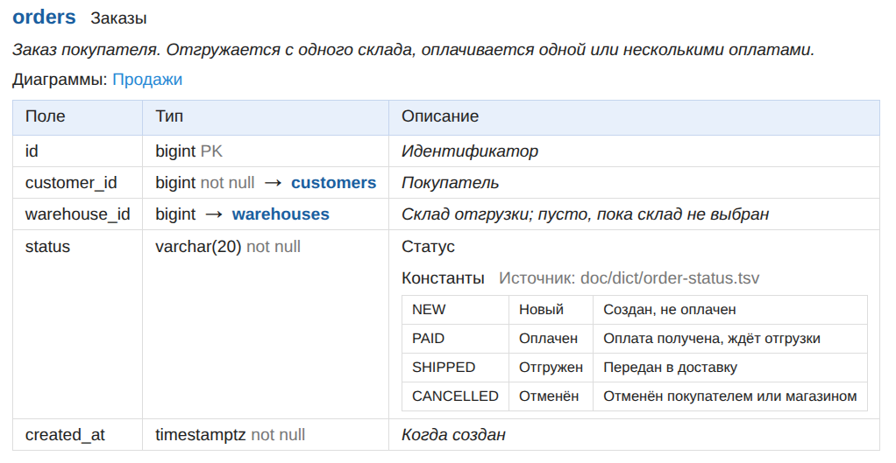
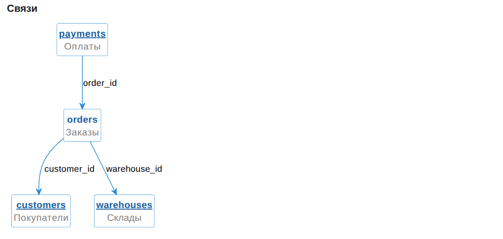

# The doc-db tool

[Утилита doc-db (readme.ru)](readme.ru.md).

Database documentation in one command: a self-contained HTML file you can open, send or publish on a website.

The tool reads the structure by itself:

- from Liquibase or Flyway migrations
- from a live PostgreSQL database.

You write only the meaning: names and descriptions of columns and tables.

## What the HTML shows

- **ER diagrams by topic**: with fields and relationship arrows. You define the table groups. Tables on a diagram are
  clickable.
  
- **Table card**:
  
    - name and description;
    - table fields:
        - name and description, data type;
        - link to the table a foreign key points to.
- **Table relationship diagram**:
  
    - the table in the center, around it the tables that reference it and the tables it references.
- **Contents**: diagrams and all tables with short names, navigation by links.
- **Value dictionaries** right at the table or field: code, name, explanation. Taken from commented Java constants or
  from `.tsv` files, so code and documentation do not drift apart.

## Why it is handy

- **Never lies**: the structure is always recomputed from the source. If the description still mentions a table,
  column or dictionary that no longer exists, the HTML is not built and the generator names what is extra. With the
  `--strict` flag, undocumented items are caught the same way.
- **The structure description lives separately**.
- **Fast**: diagrams are cached, a rebuild takes seconds.
- **Embeds into a website**: your own template extends the standard one and replaces the blocks you need (style,
  contents, the whole page).

How to connect and run: [readme.usage.md](readme.usage.md).
