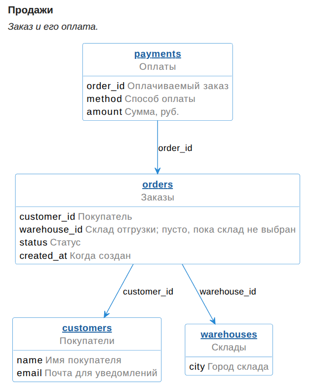
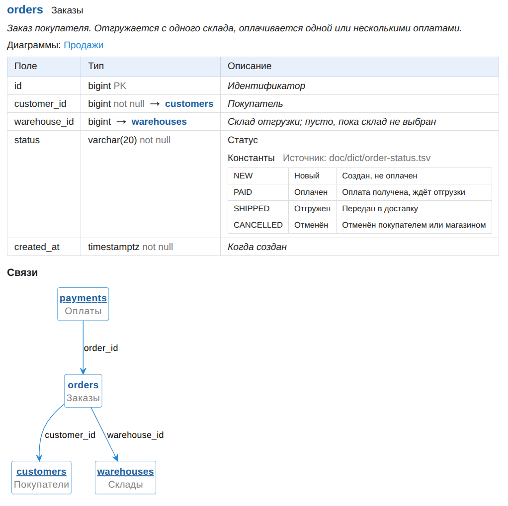

# Утилита doc-db

Документация по базе данных одной командой: самодостаточный HTML-файл, который можно открыть, отправить или выложить на
сайт.

Структуру утилита берёт сама:

- из миграций Liquibase или Flyway
- из живой PostgreSQL.

Пользователь пишет только смысл: названия и описание колонок и таблиц.

## Что видно в HTML

- **ER-диаграммы по темам**: с полями и стрелками связей. Группы таблиц задаёт пользователь. Таблицы на диаграмме
  кликабельны.
  
- **Карточка таблицы**:
  
    - название и описание;
    - **схема связей**: таблица в центре, вокруг неё те, кто ссылается на неё, и те, на кого ссылается она.
    - **поля таблицы**:
        - название и описание, тип данных;
        - ссылка на таблицу, куда ведёт внешний ключ.
- **Содержание**: диаграммы и все таблицы с краткими названиями, переход по ссылкам.
- **Справочники значений** прямо у таблицы или поля: код, название, пояснение. Берутся из Java-констант с
  комментариями или из `.tsv`-файлов, поэтому код и документация не расходятся.

## Чем удобна

- **Не врёт**: структура всегда пересчитывается из источника. Если в описании осталась таблица, колонка или
  справочник, которых уже нет, HTML не собирается, а генератор называет, что лишнее. С флагом `--strict` так же
  ловится и неописанное.
- **Описание структуры живет отдельно**.
- **Быстро**: диаграммы кэшируются, повторная сборка занимает секунды.
- **Встраивается в сайт**: свой шаблон наследует стандартный и заменяет нужные блоки (стиль, содержание,
  страницу целиком).

Как подключить и запустить: [readme.usage.ru.md](readme.usage.ru.md).
